# Лабораторная работа №3

**Маршрутизация, параметры пути и query-параметры**

**Студент:** Абдуллоев Орифжон

**Группа:** ПИЖ-б-о-25-1(1)

**Направление:** 09.03.04 «Программная инженерия»

**Вариант:** 1

**Технология:** Node.js + Express


## Цель работы

Освоить разные способы передачи данных через URL. Научиться строить гибкие маршруты с параметрами пути и query-параметрами, комбинировать их, обрабатывать вложенные ресурсы и валидировать входные данные. Понять разницу между `req.params`, `req.query` и `req.body`.

## Теоретическое обоснование

Маршрутизация сопоставляет HTTP-запрос, то есть метод и URL, с функцией-обработчиком на сервере. В Express маршрут записывается как `app.METHOD(PATH, HANDLER)`. Express проверяет маршруты строго в порядке объявления и выполняет первый подходящий, поэтому конкретные маршруты, такие как `/tasks/stats`, нужно объявлять раньше общих, таких как `/tasks/:id`, а универсальный обработчик 404 ставить последним.

Данные приходят в запросе из трёх мест. Параметры пути вида `/tasks/42` попадают в `req.params` и идентифицируют ресурс. Query-параметры после знака вопроса, например `?sort=title`, попадают в `req.query` и настраивают выборку: поиск, фильтрацию, сортировку, пагинацию. Тело запроса попадает в `req.body` и используется при создании и изменении данных. Параметры пути и query-параметры всегда приходят строками, поэтому их нужно приводить к числам и проверять.

Вложенные маршруты отражают иерархию ресурсов, например `/projects/1/tasks/5/comments/4`. Валидация нужна на каждом уровне: неверный формат параметра даёт ответ 400, а корректный параметр несуществующего ресурса даёт ответ 404. Значения sort, order и filter сверяются с белыми списками, а page и limit ограничиваются допустимым диапазоном. Необработанные исключения перехватывает глобальный обработчик ошибок и возвращает клиенту ответ 500.

| Критерий | `req.params` | `req.query` | `req.body` |
|---|---|---|---|
| Где в запросе | В пути URL | После `?` | В теле |
| Для чего | Идентификация ресурса | Фильтрация, поиск | Создание и обновление |
| Пример | `/tasks/42` | `/tasks?done=false` | `{"title": "Новая"}` |
| Тип | Строка | Строка | Любой, JSON |

## Выполнение практического примера

Практический пример, сервер с городами, лежит в папке `example-cities`. 

Запуск:

```bash
mkdir lab3-routing-params
mkdir example-cities
cd lab3-routing-params/example-cities
npm init -y
npm install express
npm install --save-dev nodemon
npm run dev
```

Код сервера в `example-cities/app.js`:

```js
const express = require('express');

const app = express();
const port = 3000;

app.use(express.json());

app.use((req, res, next) => {
  console.log(`[${new Date().toISOString()}] ${req.method} ${req.url}`);
  next();
});

const cities = [
  { id: 1, name: 'Москва', population: 13000000, country: 'Россия', area: 2561 },
  { id: 2, name: 'Санкт-Петербург', population: 5600000, country: 'Россия', area: 1439 },
  { id: 3, name: 'Новосибирск', population: 1600000, country: 'Россия', area: 505 },
  { id: 4, name: 'Екатеринбург', population: 1500000, country: 'Россия', area: 1112 },
  { id: 5, name: 'Казань', population: 1250000, country: 'Россия', area: 425 }
];

app.get('/cities', (req, res) => {
  let result = [...cities];

  const search = req.query.search;
  if (search) {
    result = result.filter(c => c.name.toLowerCase().includes(search.toLowerCase()));
  }

  const country = req.query.country;
  if (country) {
    result = result.filter(c => c.country.toLowerCase() === country.toLowerCase());
  }

  const sort = req.query.sort;
  const order = req.query.order || 'asc';
  const allowedSortFields = ['id', 'name', 'population', 'area'];
  if (sort) {
    if (!allowedSortFields.includes(sort)) {
      return res.status(400).json({
        error: `Поле сортировки должно быть одним из: ${allowedSortFields.join(', ')}`
      });
    }
    if (!['asc', 'desc'].includes(order)) {
      return res.status(400).json({ error: 'Параметр order должен быть asc или desc' });
    }
    result.sort((a, b) => (order === 'desc'
      ? (a[sort] < b[sort] ? 1 : -1)
      : (a[sort] > b[sort] ? 1 : -1)));
  }

  const page = parseInt(req.query.page) || 1;
  const limit = parseInt(req.query.limit) || 10;
  if (page < 1) return res.status(400).json({ error: 'page должен быть >= 1' });
  if (limit < 1 || limit > 100) {
    return res.status(400).json({ error: 'limit должен быть от 1 до 100' });
  }

  const start = (page - 1) * limit;
  const paginated = result.slice(start, start + limit);

  res.json({
    count: result.length,
    page,
    limit,
    totalPages: Math.ceil(result.length / limit),
    cities: paginated
  });
});

app.get('/cities/:id', (req, res) => {
  const id = parseInt(req.params.id);
  if (isNaN(id)) {
    return res.status(400).json({ error: 'ID должен быть числом' });
  }
  const city = cities.find(c => c.id === id);
  if (!city) {
    return res.status(404).json({ error: 'Город не найден' });
  }
  res.json(city);
});

app.get('/cities/:id/area', (req, res) => {
  const id = parseInt(req.params.id);
  const city = cities.find(c => c.id === id);
  if (!city) {
    return res.status(404).json({ error: 'Город не найден' });
  }
  res.json({ city: city.name, area: city.area, unit: 'км²' });
});

app.get('/cities/:id/details', (req, res) => {
  const id = parseInt(req.params.id);
  const city = cities.find(c => c.id === id);
  if (!city) {
    return res.status(404).json({ error: 'Город не найден' });
  }
  const districts = [
    { id: 1, name: 'Центральный', cityId: id },
    { id: 2, name: 'Северный', cityId: id }
  ];
  res.json({ city, districts, attractions: ['Кремль', 'Парк', 'Музей'] });
});

app.get('/countries/:country/cities', (req, res) => {
  const country = req.params.country;
  const filtered = cities.filter(c => c.country.toLowerCase() === country.toLowerCase());
  res.json({ country, count: filtered.length, cities: filtered });
});

app.get('/countries/:country/cities/:cityId', (req, res) => {
  const { country, cityId } = req.params;
  const id = parseInt(cityId);
  const city = cities.find(c => c.id === id && c.country.toLowerCase() === country.toLowerCase());
  if (!city) {
    return res.status(404).json({ error: `Город с ID=${cityId} не найден в стране ${country}` });
  }
  res.json({ country, city });
});

app.use((req, res) => {
  res.status(404).json({ error: 'Маршрут не найден' });
});

app.listen(port, () => {
  console.log(`Сервер запущен на http://localhost:${port}`);
});
```

Проверка запросов:

| № | Запрос | Результат | Скриншот |
|---|---|---|---|
| 1 | `GET /cities` | 200, все города | 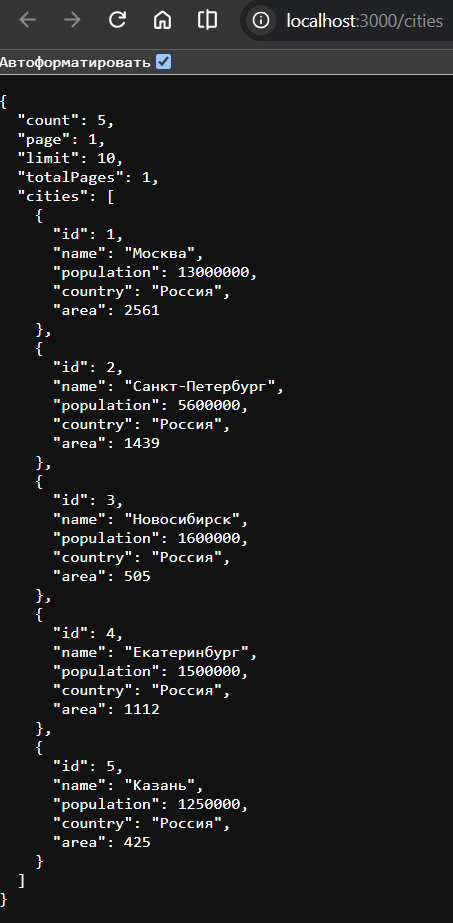 |
| 2 | `GET /cities/1` | 200, Москва | 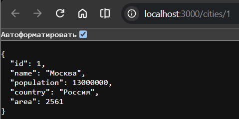 |
| 3 | `GET /cities/999` | 404 | 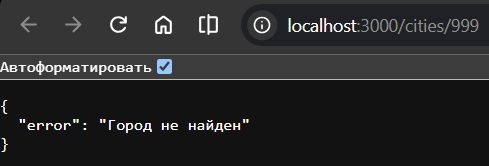 |
| 4 | `GET /cities/abc` | 400 | 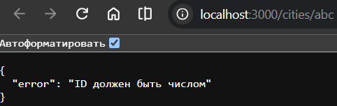 |
| 5 | `GET /cities/1/area` | 200, площадь | 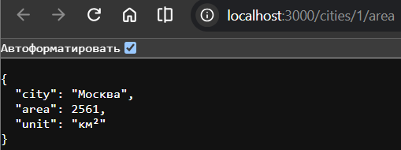 |
| 6 | `GET /countries/Россия/cities` | 200, города страны | 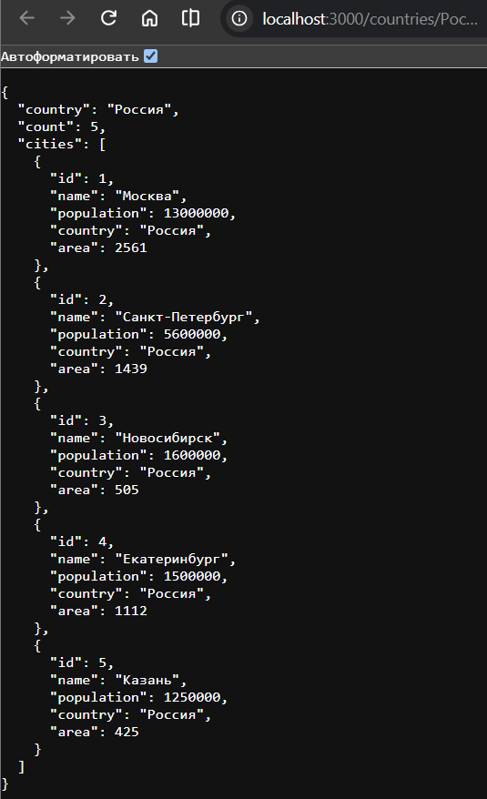 |
| 7 | `GET /cities?search=Москва` | 200, поиск | 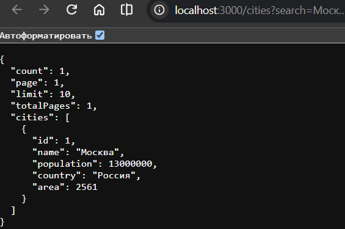 |
| 8 | `GET /cities?sort=population&order=desc` | 200, сортировка | 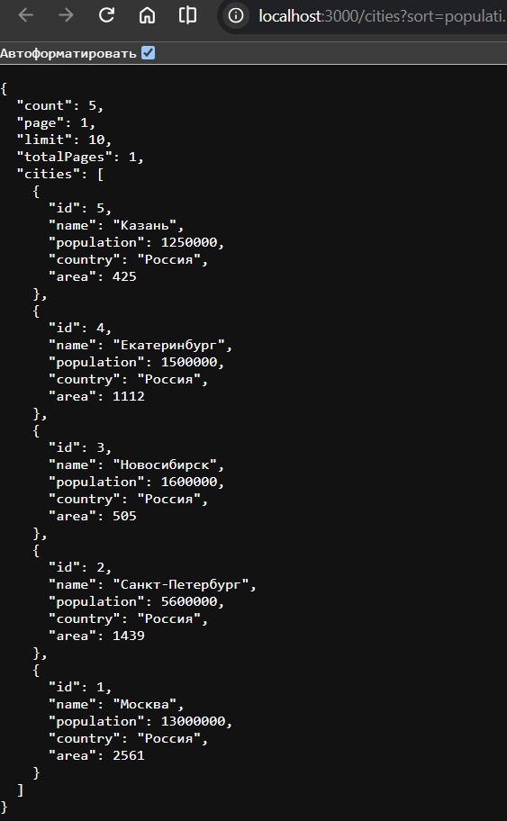 |
| 9 | `GET /cities?page=1&limit=2` | 200, пагинация |  |
| 10 | `GET /cities/1/details` | 200, вложенные данные | 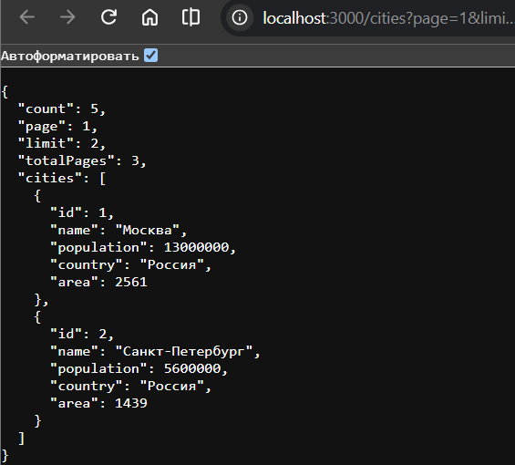 |
| 11 | `GET /countries/Россия/cities/1` | 200, город в стране | 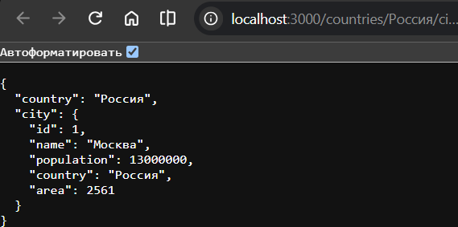 |
| 12 | `GET /anything-else` | 404 | 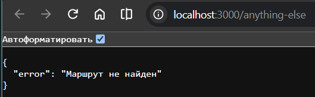 |

## Выполнение индивидуального задания

Вариант 1, сущность Задачи. Поля: `id`, `title`, `done`, `priority`, `deadline`, `projectId`. Связанные сущности: Проекты и Комментарии. Статистика: количество выполненных задач. Связь: по приоритету.

Запуск:

```bash
npm install
npm run dev
```

### Эндпоинты

| Группа | Маршрут | Назначение |
|---|---|---|
| Базовые | `GET /tasks` | Все задачи, поддерживает query-параметры |
| Базовые | `GET /tasks/:id` | Одна задача |
| Базовые | `GET /tasks/:id/comments` | Комментарии задачи |
| Базовые | `GET /projects/:projectId/tasks` | Задачи проекта, поддерживает query-параметры |
| Вложенные | `GET /projects/:projectId/tasks/:taskId` | Задача в проекте |
| Составные | `GET /projects/:projectId/tasks/:taskId/comments/:commentId` | Комментарий задачи в проекте, три параметра пути |
| Дополнительные | `GET /tasks/stats` | Статистика |
| Дополнительные | `GET /tasks/:id/related` | Задачи с тем же приоритетом |
| Служебные | `GET /error-test` | Намеренная ошибка для проверки ответа 500 |

Query-параметры для `GET /tasks` и `GET /projects/:projectId/tasks`:

| Параметр | Значения | Пример |
|---|---|---|
| `search` | Подстрока в названии, без учёта регистра | `?search=отчёт` |
| `filter` | `done:true`, `done:false`, `priority:low`, `priority:medium`, `priority:high`, можно повторять | `?filter=done:false&filter=priority:high` |
| `sort` | `id`, `title`, `priority`, `deadline` | `?sort=deadline` |
| `order` | `asc`, `desc` | `?order=desc` |
| `page` | Целое число не меньше 1, по умолчанию 1 | `?page=2` |
| `limit` | Целое число от 1 до 100, по умолчанию 10 | `?limit=5` |

Приоритет сортируется по смыслу, low меньше medium меньше high, а не по алфавиту. Задачи без дедлайна всегда оказываются в конце списка.

### Код сервера `app.js`

Полный код сервера находится в файле `app.js`. 

**Листинг 1.** Подключение Express и логирование запросов

```js
const express = require('express');

const app = express();
const port = 3000;

app.use((req, res, next) => {
  const start = Date.now();
  res.on('finish', () => {
    const ip = (req.ip || '').replace('::ffff:', '');
    console.log(`[${new Date().toISOString()}] ${ip} ${req.method} ${req.originalUrl} -> ${res.statusCode} ${Date.now() - start} ms`);
  });
  next();
});
```

Пояснение: middleware подключён первым, поэтому через него проходит каждый запрос. Запись в консоль делается по событию finish, когда ответ уже отправлен, и потому в строке есть код ответа и время выполнения. Вызов next передаёт запрос дальше. Префикс `::ffff:` убирается, чтобы IPv4-адрес выглядел привычно.

**Листинг 2.** Данные в памяти сервера

```js
const projects = [
  { id: 1, name: 'Учёба' },
  { id: 2, name: 'Дом' },
  { id: 3, name: 'Работа' }
];

const tasks = [
  { id: 1, title: 'Сделать ЛР №2', done: true, priority: 'high', deadline: '2026-10-05', projectId: 1 },
  { id: 2, title: 'Изучить HTTP-методы', done: true, priority: 'medium', deadline: '2026-09-30', projectId: 1 },
  { id: 3, title: 'Оформить отчёт', done: false, priority: 'high', deadline: '2026-10-07', projectId: 1 },
  { id: 4, title: 'Купить продукты', done: false, priority: 'low', deadline: null, projectId: 2 },
  { id: 5, title: 'Сделать ЛР №3', done: false, priority: 'high', deadline: '2026-11-15', projectId: 1 },
  { id: 6, title: 'Убраться в комнате', done: false, priority: 'medium', deadline: '2026-11-10', projectId: 2 },
  { id: 7, title: 'Подготовить презентацию', done: false, priority: 'medium', deadline: '2026-11-20', projectId: 3 },
  { id: 8, title: 'Ответить на письма', done: true, priority: 'low', deadline: null, projectId: 3 }
];

const comments = [
  { id: 1, taskId: 1, author: 'Анна', text: 'Не забудь про скриншоты' },
  { id: 2, taskId: 1, author: 'Иван', text: 'Проверь коды ответов' },
  { id: 3, taskId: 3, author: 'Анна', text: 'Добавить вывод' },
  { id: 4, taskId: 5, author: 'Иван', text: 'Сначала сделай маршруты' },
  { id: 5, taskId: 5, author: 'Анна', text: 'Потом валидацию' }
];
```

Пояснение: база данных не используется, данные лежат в трёх массивах и пропадают при перезапуске сервера. Связи между сущностями задаются полями: `projectId` связывает задачу с проектом, `taskId` связывает комментарий с задачей. У задач без срока в поле `deadline` стоит null.

**Листинг 3.** Константы и валидация параметров пути

```js
const PRIORITIES = ['low', 'medium', 'high'];
const PRIORITY_RANK = { low: 1, medium: 2, high: 3 };
const SORT_FIELDS = ['id', 'title', 'priority', 'deadline'];
const FILTER_FIELDS = ['done', 'priority'];

function isPositiveInt(value) {
  return typeof value === 'string' && /^\d+$/.test(value) && Number(value) >= 1;
}

// Проверяет все перечисленные параметры пути. При ошибке сразу отвечает 400 и возвращает null
function readIds(req, res, ...names) {
  const ids = {};
  for (const name of names) {
    const value = req.params[name];
    if (!isPositiveInt(value)) {
      res.status(400).json({
        error: `${name} должен быть положительным целым числом`,
        received: value
      });
      return null;
    }
    ids[name] = Number(value);
  }
  return ids;
}
```

Пояснение: списки PRIORITIES, SORT_FIELDS и FILTER_FIELDS работают как белые списки допустимых значений. Параметры пути приходят строками, поэтому функция isPositiveInt проверяет их регулярным выражением. Это строже, чем parseInt, который принимает строку 1abc как число 1. Функция readIds проверяет любое количество параметров и при первой ошибке сама отправляет ответ 400, а обработчик маршрута получает null и просто выходит.

**Листинг 4.** Поиск ресурсов и ответ 404

```js
function findProject(res, projectId) {
  const project = projects.find(p => p.id === projectId);
  if (!project) {
    res.status(404).json({ error: `Проект с id=${projectId} не найден` });
    return null;
  }
  return project;
}

function findTask(res, taskId) {
  const task = tasks.find(t => t.id === taskId);
  if (!task) {
    res.status(404).json({ error: `Задача с id=${taskId} не найдена` });
    return null;
  }
  return task;
}

function findTaskInProject(res, projectId, taskId) {
  if (!findProject(res, projectId)) return null;
  const task = tasks.find(t => t.id === taskId && t.projectId === projectId);
  if (!task) {
    res.status(404).json({ error: `Задача с id=${taskId} не найдена в проекте ${projectId}` });
    return null;
  }
  return task;
}
```

Пояснение: формат id проверяет readIds и отвечает 400, а существование ресурса проверяют эти функции и отвечают 404. Функция findTaskInProject проверяет цепочку: сначала проект, затем принадлежность задачи этому проекту. Поэтому задача, которая существует, но лежит в другом проекте, даёт 404.

**Листинг 5.** Функция queryTasks, поиск и фильтрация

```js
function queryTasks(list, query) {
  const { search, filter, sort, order = 'asc' } = query;
  let result = [...list];

  if (search !== undefined) {
    if (typeof search !== 'string' || search.length > 100) {
      return { error: 'search должен быть строкой длиной до 100 символов' };
    }
    const q = search.toLowerCase();
    result = result.filter(t => t.title.toLowerCase().includes(q));
  }

  if (filter !== undefined) {
    const filters = Array.isArray(filter) ? filter : [filter];
    for (const f of filters) {
      const sep = typeof f === 'string' ? f.indexOf(':') : -1;
      if (sep < 1) {
        return { error: 'filter должен иметь вид поле:значение, например filter=done:false' };
      }
      const field = f.slice(0, sep);
      const value = f.slice(sep + 1);
      if (!FILTER_FIELDS.includes(field)) {
        return { error: `фильтровать можно по полям: ${FILTER_FIELDS.join(', ')}` };
      }
      if (field === 'done' && !['true', 'false'].includes(value)) {
        return { error: 'для поля done допустимы значения true и false' };
      }
      if (field === 'priority' && !PRIORITIES.includes(value)) {
        return { error: `для поля priority допустимы значения: ${PRIORITIES.join(', ')}` };
      }
      result = result.filter(t => String(t[field]) === value);
    }
  }
```

Пояснение: функция получает список и query-параметры и возвращает либо объект с ошибкой, либо готовый ответ. Работа идёт с копией массива, исходные данные не меняются. Поиск не учитывает регистр. Если параметр filter передан несколько раз, Express превращает его в массив, и условия применяются по очереди.

**Листинг 6.** Функция queryTasks, сортировка

```js
  if (!['asc', 'desc'].includes(order)) {
    return { error: 'order должен быть asc или desc' };
  }
  if (sort !== undefined) {
    if (!SORT_FIELDS.includes(sort)) {
      return { error: `sort должен быть одним из: ${SORT_FIELDS.join(', ')}` };
    }
    const dir = order === 'asc' ? 1 : -1;
    const key = t => (sort === 'priority' ? PRIORITY_RANK[t.priority] : t[sort]);
    result.sort((a, b) => {
      const x = key(a);
      const y = key(b);
      if (x === y) return 0;
      if (x === null) return 1;
      if (y === null) return -1;
      return (x > y ? 1 : -1) * dir;
    });
  }
```

Пояснение: поле сортировки проверяется по белому списку, направление должно быть asc или desc. Приоритет сортируется по рангу, а не по алфавиту, иначе high оказался бы раньше low. Задачи без дедлайна всегда уходят в конец списка независимо от направления.

**Листинг 7.** Функция queryTasks, пагинация, и отправка списка

```js
  const { page: rawPage = '1', limit: rawLimit = '10' } = query;
  if (!isPositiveInt(rawPage)) {
    return { error: 'page должен быть целым числом не меньше 1' };
  }
  if (!isPositiveInt(rawLimit) || Number(rawLimit) > 100) {
    return { error: 'limit должен быть целым числом от 1 до 100' };
  }
  const page = Number(rawPage);
  const limit = Number(rawLimit);
  const start = (page - 1) * limit;

  return {
    count: result.length,
    page,
    limit,
    totalPages: Math.ceil(result.length / limit),
    items: result.slice(start, start + limit)
  };
}

function sendList(res, list, query) {
  const out = queryTasks(list, query);
  if (out.error) return res.status(400).json({ error: out.error });
  res.json(out);
}
```

Пояснение: по умолчанию page равен 1, а limit равен 10. Верхняя граница limit в 100 защищает сервер от слишком больших выборок. Количество страниц считается как округление вверх от количества задач, делённого на limit. Функция sendList превращает результат queryTasks в ответ 400 или 200 и используется сразу в двух маршрутах.

**Листинг 8.** Список задач и статистика

```js
// /tasks/stats объявлен раньше /tasks/:id, иначе stats попадёт в параметр id
app.get('/tasks', (req, res) => {
  sendList(res, tasks, req.query);
});

app.get('/tasks/stats', (req, res) => {
  const done = tasks.filter(t => t.done).length;
  const byPriority = { low: 0, medium: 0, high: 0 };
  tasks.forEach(t => byPriority[t.priority]++);

  const deadlines = tasks.map(t => t.deadline).filter(d => d !== null).sort();
  const perTask = tasks.map(t => comments.filter(c => c.taskId === t.id).length);

  res.json({
    total: tasks.length,
    done,
    notDone: tasks.length - done,
    byPriority,
    deadline: {
      earliest: deadlines[0] ?? null,
      latest: deadlines[deadlines.length - 1] ?? null
    },
    comments: {
      total: comments.length,
      average: Number((comments.length / tasks.length).toFixed(2)),
      min: Math.min(...perTask),
      max: Math.max(...perTask)
    }
  });
});
```

Пояснение: Express выбирает первый подходящий маршрут в порядке объявления. Если поставить маршрут с параметром id выше, слово stats будет принято за значение id. Статистика считается за один проход по данным: количество задач, выполненные, распределение по приоритетам, самый ранний и самый поздний дедлайн, среднее, минимум и максимум комментариев на задачу.

**Листинг 9.** Одна задача, её комментарии и связанные задачи

```js
app.get('/tasks/:id', (req, res) => {
  const ids = readIds(req, res, 'id');
  if (!ids) return;
  const task = findTask(res, ids.id);
  if (!task) return;
  res.json(task);
});

app.get('/tasks/:id/comments', (req, res) => {
  const ids = readIds(req, res, 'id');
  if (!ids) return;
  const task = findTask(res, ids.id);
  if (!task) return;
  const list = comments.filter(c => c.taskId === task.id);
  res.json({ taskId: task.id, count: list.length, items: list });
});

app.get('/tasks/:id/related', (req, res) => {
  const ids = readIds(req, res, 'id');
  if (!ids) return;
  const task = findTask(res, ids.id);
  if (!task) return;
  const related = tasks.filter(t => t.priority === task.priority && t.id !== task.id);
  res.json({ taskId: task.id, priority: task.priority, count: related.length, items: related });
});
```

Пояснение: во всех трёх маршрутах одинаковый порядок: проверка формата id с ответом 400, затем поиск ресурса с ответом 404, затем


### Скриншоты

| № | Запрос | Ожидаемый результат | Скриншот |
|---|---|---|---|
| 1 | `GET /tasks` | 200 | 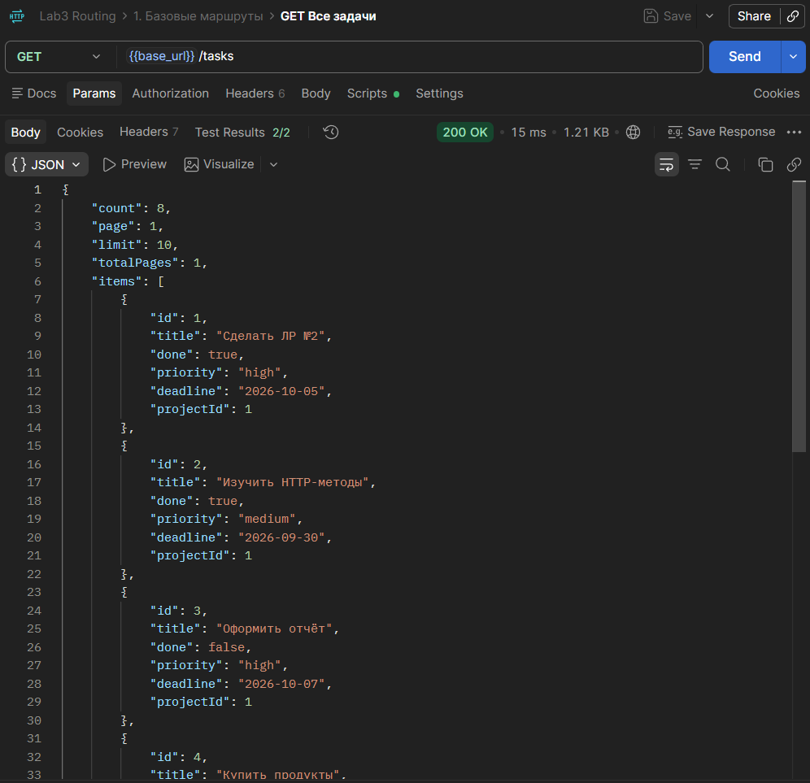 |
| 2 | `GET /tasks/1` | 200 | 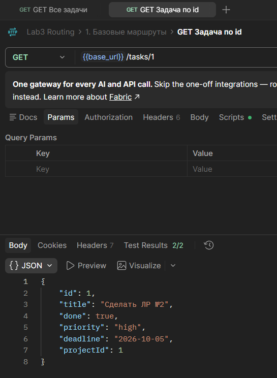 |
| 3 | `GET /tasks/1/comments` | 200 | 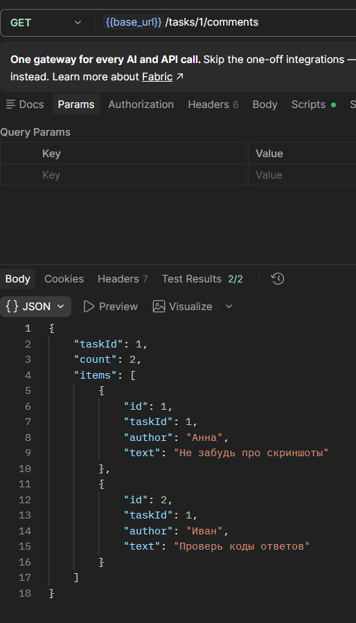 |
| 4 | `GET /projects/1/tasks` | 200 | 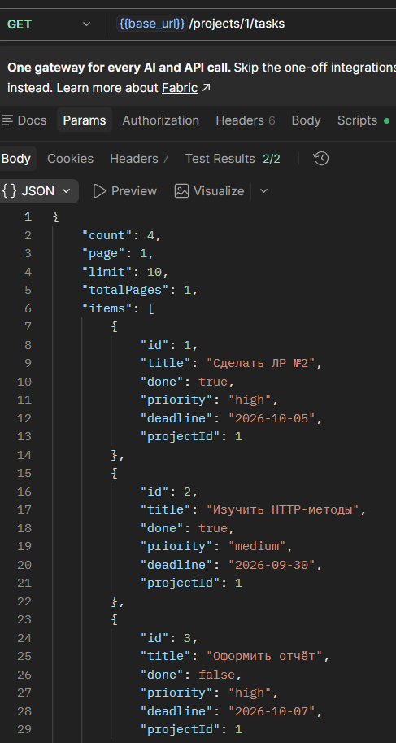 |
| 5 | `GET /projects/1/tasks/3` | 200 | 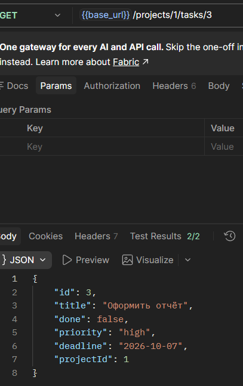 |
| 6 | `GET /projects/1/tasks/5/comments/4` | 200 | 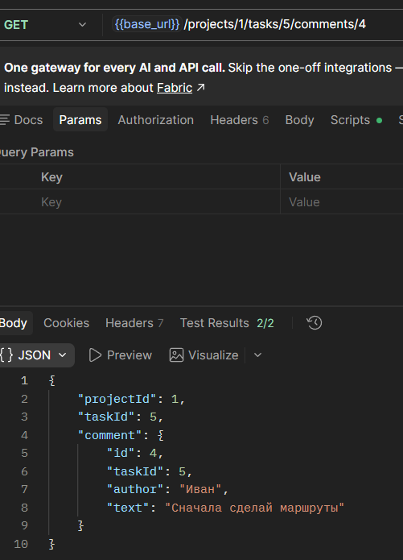 |
| 7 | `GET /tasks?search=отчёт` | 200 | 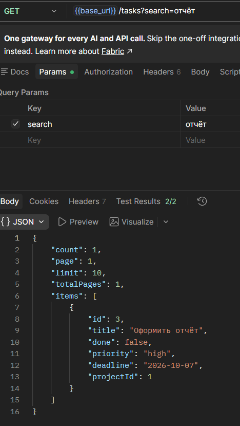 |
| 8 | `GET /tasks?sort=priority&order=desc` | 200 | 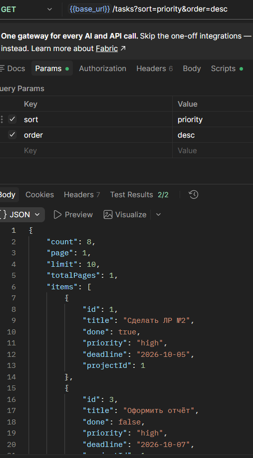 |
| 9 | `GET /tasks?page=1&limit=3` | 200 | 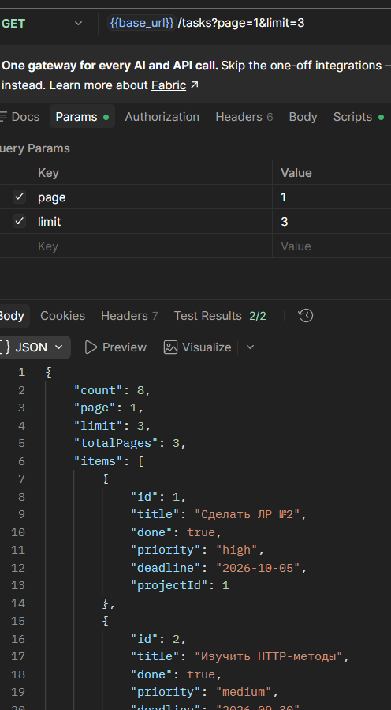 |
| 10 | `GET /tasks?filter=done:false` | 200 | 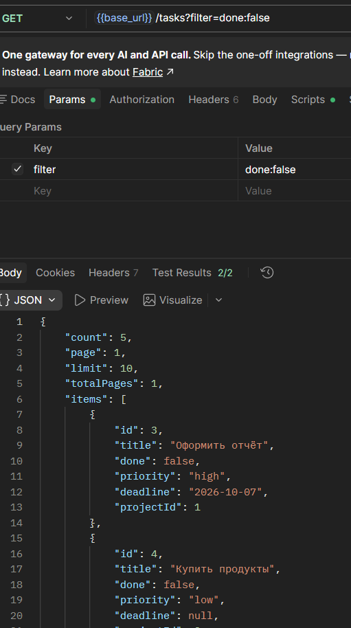 |
| 11 | `GET /tasks/stats` | 200 | 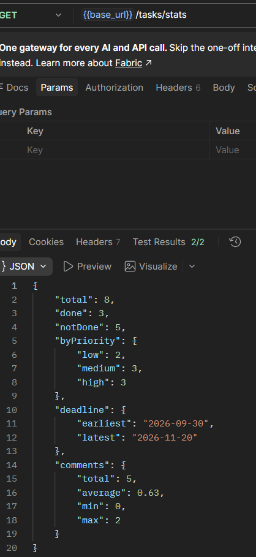 |
| 12 | `GET /tasks/5/related` | 200 | 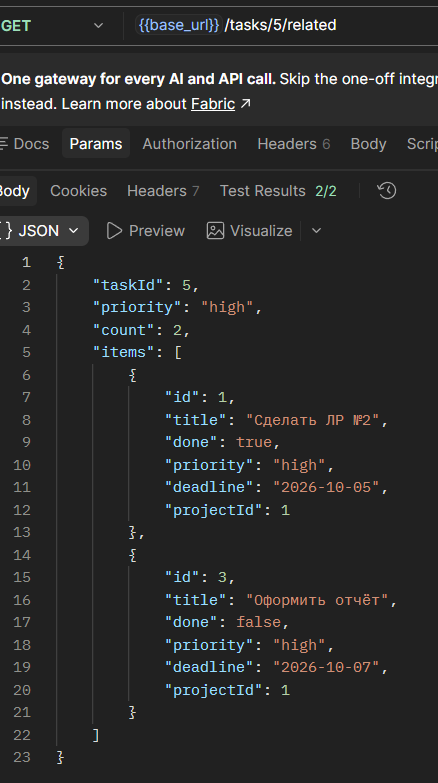 |
| 13 | `GET /tasks/abc` | 400 | 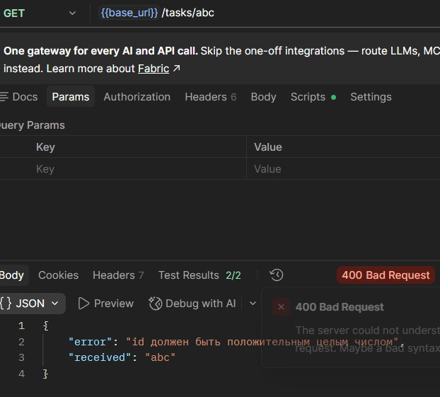 |
| 14 | `GET /tasks/999` | 404 | 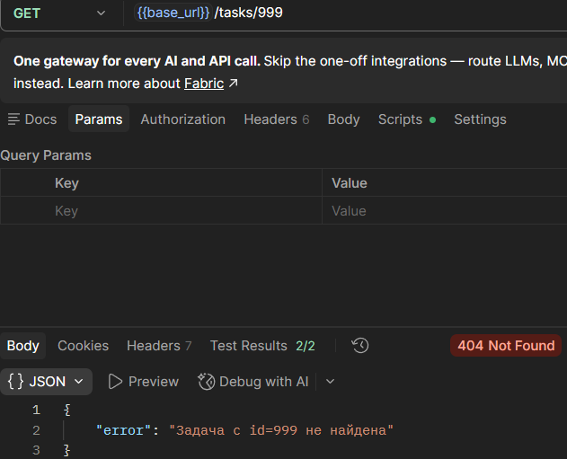 |
| 15 | `GET /projects/2/tasks/3` | 404 | 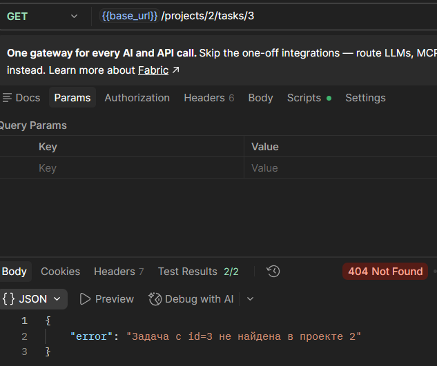 |
| 16 | `GET /tasks?sort=color` | 400 | 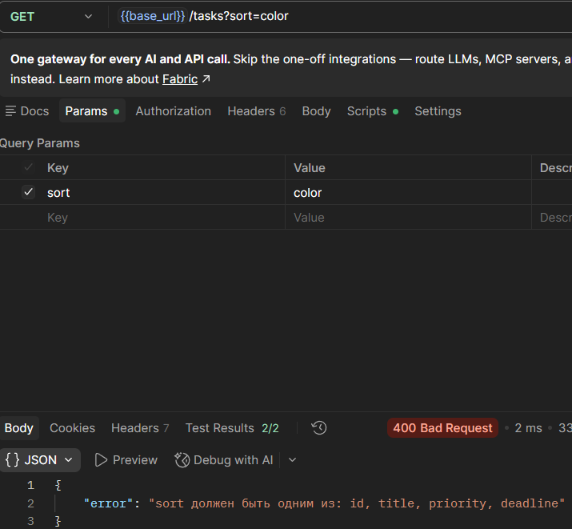 |
| 17 | `GET /tasks?limit=1000` | 400 | 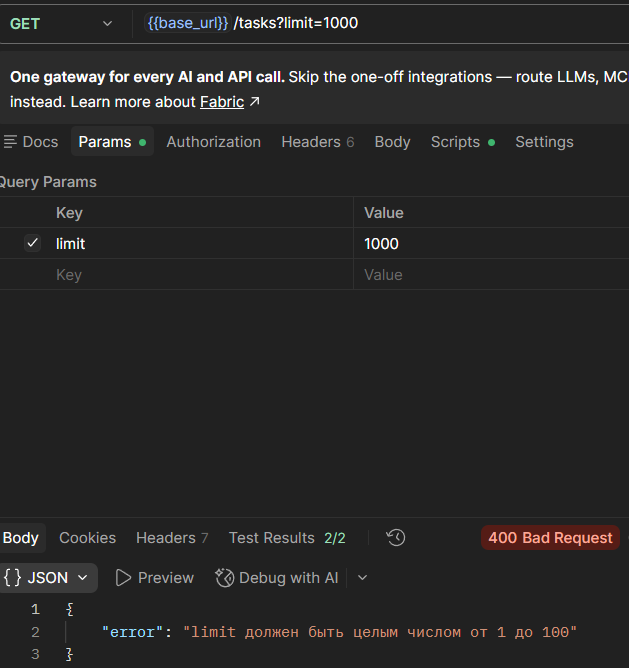 |
| 18 | `GET /anything-else` | 404 | 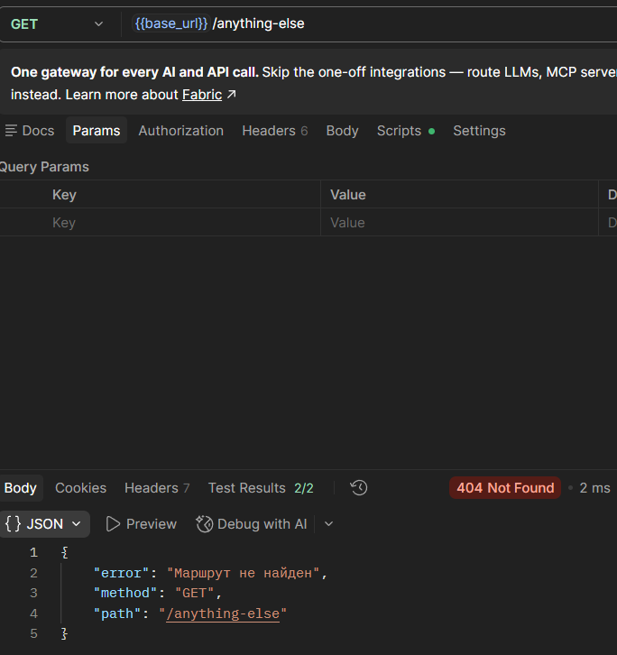 |
| 19 | `GET /error-test` | 500 | 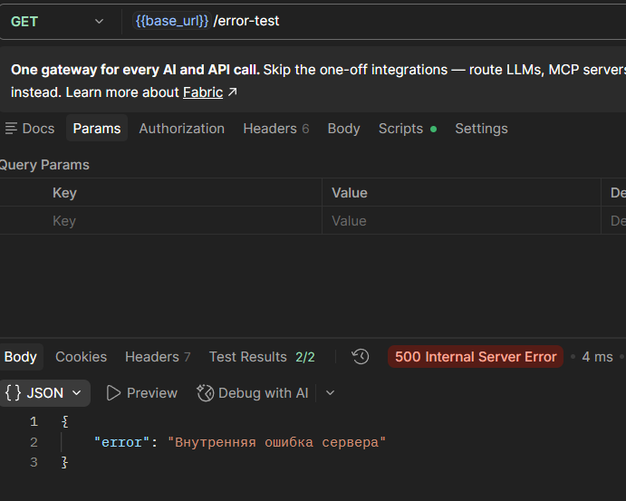 |
| 20 | Журнал запросов в консоли | Время, IP, метод, URL | 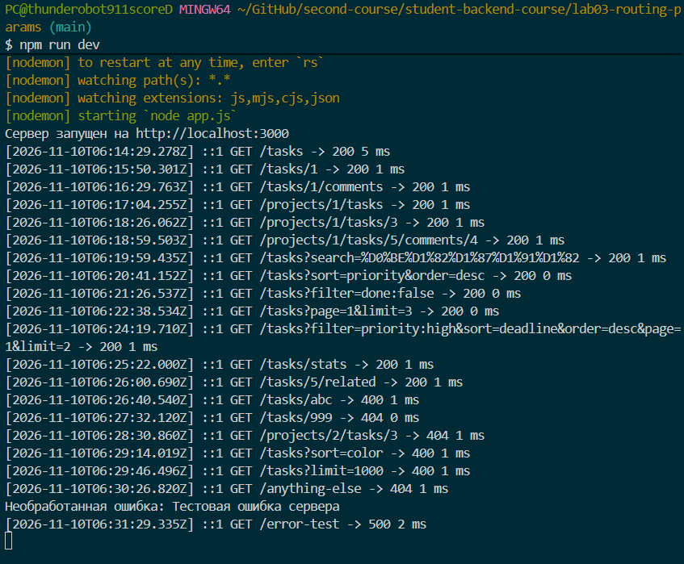 |
| 21 | Collection Runner | 27 запросов, 54 проверки, все пройдены | 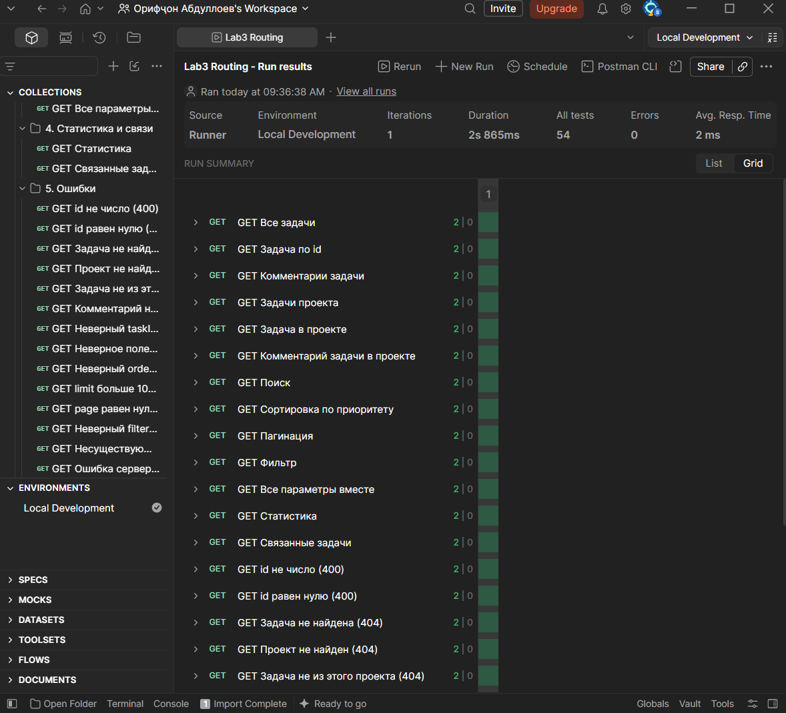 |

Строка журнала в консоли содержит время, IP, метод, URL, код ответа и длительность:

```
[2026-11-08T14:48:57.604Z] 127.0.0.1 GET /tasks -> 200 4 ms
```

Коллекция Postman лежит в файле `Lab3_Routing.postman_collection.json`, адрес сервера задаётся переменной коллекции `base_url`.

## Ответы на контрольные вопросы

**20. Как комбинировать параметры пути и query-параметры в одном запросе?**
Параметр пути указывает, с каким ресурсом работаем, а query-параметры настраивают выборку внутри него. Например, `GET /projects/1/tasks?filter=done:false&sort=deadline&page=1&limit=5` вернёт невыполненные задачи проекта 1, отсортированные по дедлайну. В коде `projectId` берётся из `req.params`, а остальное из `req.query`. Сначала список сужается до задач проекта, затем к нему применяются поиск, фильтр, сортировка и пагинация.

**21. Как реализовать вложенные маршруты с несколькими уровнями?**
Каждый уровень вложенности добавляет в путь свой параметр: `/projects/:projectId/tasks/:taskId/comments/:commentId`. Все три параметра доступны в `req.params`. Важно проверять принадлежность по цепочке. Сначала проверяется, что проект существует, затем что задача принадлежит этому проекту, затем что комментарий принадлежит этой задаче. Поэтому запрос `/projects/2/tasks/3` возвращает 404, хотя задача 3 существует, но лежит в проекте 1.

**22. Как обработать wildcard-маршрут и почему он должен быть последним?**
Express выбирает первый подходящий маршрут в порядке объявления. Обработчик `app.use` без пути подходит под любой URL, поэтому, если поставить его выше остальных, он перехватит все запросы и до реальных маршрутов дело не дойдёт. Поставленный в конец, он срабатывает только для адресов, которые не совпали ни с одним маршрутом, и возвращает 404 с понятным сообщением.

**23. Как реализовать глобальный обработчик ошибок?**
Это middleware с четырьмя аргументами `err, req, res, next`, объявленное после всех маршрутов. Express распознаёт его именно по числу аргументов. Он перехватывает исключения, возникшие в обработчиках, пишет подробности в консоль и отправляет клиенту ответ 500 с общим сообщением, не раскрывая устройство сервера. Для проверки в проекте есть маршрут `/error-test`, который намеренно выбрасывает ошибку.

**24. Как логировать все запросы с IP-адресом клиента?**
Нужен middleware, который подключается первым и подписывается на событие `finish` объекта `res`. Тогда в строку попадают и данные запроса, и итог: `req.ip`, `req.method`, `req.originalUrl`, `res.statusCode` и время выполнения. Если сервер стоит за прокси, нужно включить настройку `trust proxy`, иначе `req.ip` покажет адрес самого прокси. Префикс `::ffff:` у IPv4-адресов в проекте убирается.

**25. Как защитить API от слишком больших значений limit?**
Значение `limit` приходит строкой, поэтому его нужно привести к числу и проверить диапазон. В проекте допустимы целые числа от 1 до 100, иначе возвращается 400. Без такого ограничения клиент мог бы запросить `limit=1000000` и заставить сервер собрать и отправить всю коллекцию, что нагружает память и сеть. Для необязательного параметра задаётся значение по умолчанию 10.

**26. Как реализовать статистику по коллекции?**
Коллекция обходится методами `filter`, `forEach` и `map`, а результаты складываются в один объект. В проекте считаются общее количество задач, количество выполненных, распределение по приоритетам, самый ранний и самый поздний дедлайн, среднее, минимальное и максимальное число комментариев на задачу. Маршрут `/tasks/stats` объявлен раньше `/tasks/:id`, иначе слово stats было бы принято за значение `id`.

## Вывод

В работе реализован REST-подобный API для задач и проектов на Node.js и Express, который использует все три источника данных запроса. Сделаны базовые маршруты с параметрами пути, вложенные маршруты на три уровня, поиск, фильтрация, сортировка и пагинация, эндпоинт статистики, выборка связанных задач, логирование с IP, универсальный обработчик 404 и глобальный обработчик ошибок 500. Все эндпоинты проверены в Postman, коллекция из 27 запросов с 54 автотестами выполняется без ошибок.

Нового узнал, что порядок объявления маршрутов влияет на работу сервера, что параметры пути и query-параметры приходят строками и требуют проверки, и что `parseInt` принимает строку `1abc` как число 1, поэтому для строгой проверки id лучше использовать регулярное выражение. Основная сложность была в проверке принадлежности по цепочке в длинных вложенных маршрутах, а также в сортировке по приоритету, которая по алфавиту даёт неверный порядок.

## Список использованных источников

1. Express, Routing: https://expressjs.com/en/guide/routing.html
2. Express, Request: https://expressjs.com/en/4x/api.html#req
3. Express, Error handling: https://expressjs.com/en/guide/error-handling.html
4. MDN, HTTP-методы: https://developer.mozilla.org/ru/docs/Web/HTTP/Methods
5. MDN, Коды состояния HTTP: https://developer.mozilla.org/ru/docs/Web/HTTP/Status
6. REST API Tutorial: https://restfulapi.net/
7. Postman Learning Center: https://learning.postman.com/
